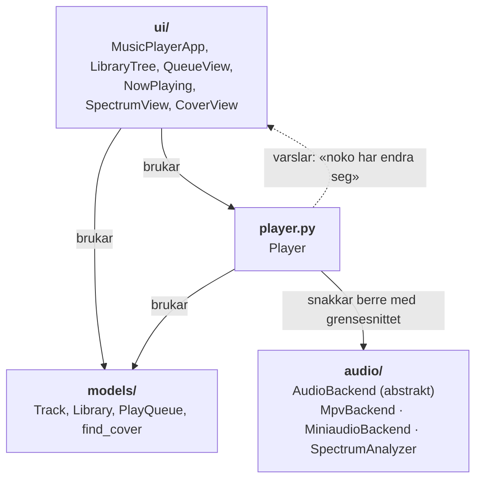
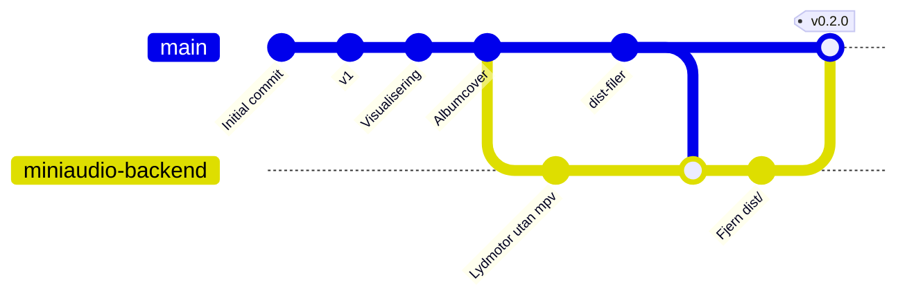

# Korleis det heng saman

Dette er ein gjennomgang av korleis musikkspelaren vart til, frå eit enkelt eksempel i undervisninga med ein meny i terminalen,
til ein publisert pakke som kven som helst kan installere med éin kommando. Dokumentet forklarer både *kva*
me gjorde og *kvifor*, og er skrive for alle som er nysgjerrige på korleis eit litt større program heng saman.

**Innhald**

1. [Utgangspunktet](#1-utgangspunktet)
2. [Val av språk og verktøy](#2-val-av-språk-og-verktøy)
3. [Arkitekturen: lag som ikkje veit for mykje om kvarandre](#3-arkitekturen-lag-som-ikkje-veit-for-mykje-om-kvarandre)
4. [Klassane, éin etter éin](#4-klassane-éin-etter-éin)
5. [Trådar: når fleire ting skjer samtidig](#5-trådar-når-fleire-ting-skjer-samtidig)
6. [Spektrumanalysatoren](#6-spektrumanalysatoren)
7. [Albumcover i terminalen](#7-albumcover-i-terminalen)
8. [Ein lydmotor til: kvifor abstraksjonen lønte seg](#8-ein-lydmotor-til-kvifor-abstraksjonen-lønte-seg)
9. [Testing: korleis me visste at ting fungerte](#9-testing-korleis-me-visste-at-ting-fungerte)
10. [Feil me fann, og kva dei lærte oss](#10-feil-me-fann-og-kva-dei-lærte-oss)
11. [Frå kode på maskina mi til pakke på PyPI](#11-frå-kode-på-maskina-mi-til-pakke-på-pypi)
12. [Ordliste](#12-ordliste)

---

## 1. Utgangspunktet

Startpunktet var `utgangspunkt.py`: om lag 200 linjer med tre klassar, `Track`, `Playlist` og `Player`,
og ei `while`-løkke med ein nummerert meny:

```
Funksjonar:
1: Vel lydfil
2: Spele lydfil
3: Pause/unpause lydfil
...
Kva vil du gjere?
```

Det var ein god start, med klassar som hadde tydelege ansvar. Men det hadde nokre grunnleggjande avgrensingar:

| Avgrensing | Kvifor det er eit problem |
|---|---|
| `input()` stoppar heile programmet | Medan programmet ventar på tastetrykk, kan ingenting anna skje: ingen fremdriftslinje, ingen automatisk neste låt. |
| `pygame` som lydmotor | Dårleg FLAC-støtte, ingen måte å lese av posisjonen i låta på, upåliteleg spoling. |
| Låtane er hardkoda | Tittel og sjanger står i koden i staden for å bli lesne frå filene. |
| `get_title()`, `get_filename()` … | Fungerer, men er ikkje vanleg Python-stil. |

Målet var ein spelar der du peikar på ei mappe med musikk og er i gang, og som oppfører seg som ein *ekte*
musikkspelar.

## 2. Val av språk og verktøy

Me vurderte Python, Rust og Go. Me valde **Python**, fordi:

- Utgangspunktet og kunnskapen var allereie der.
- Flaskehalsen i ein musikkspelar er nesten aldri språket. Det tunge arbeidet (å dekode lyd) blir gjort
  av ferdige bibliotek skrivne i C uansett.
- Python har gode bibliotek for nett denne oppgåva.

Bibliotek me enda opp med:

| Bibliotek | Kva det gjer for oss |
|---|---|
| [Textual](https://textual.textualize.io/) | Grensesnittet: panel, tre, tabellar, tastatur, mus og fargar. |
| [mutagen](https://mutagen.readthedocs.io/) | Les taggar (tittel, artist, album, cover) frå MP3, FLAC m.fl. |
| [mpv](https://mpv.io/) / `python-mpv` | Lydmotor nr. 1: speler nesten alt, med saumlause overgangar. |
| [miniaudio](https://github.com/irmen/pyminiaudio) | Lydmotor nr. 2, og dekoding for spektrumanalysatoren. |
| [numpy](https://numpy.org/) | Rask matematikk på store tabellar med tal (FFT). |
| [Pillow](https://python-pillow.org/) | Opnar og skalerer bilete (albumcover). |

## 3. Arkitekturen: lag som ikkje veit for mykje om kvarandre

Den viktigaste ideen i heile prosjektet er at **kvar del berre veit om det den treng**. Programmet er
delt i lag:



Reglane er:

- **`models/`** er rein logikk. Køen veit ingenting om lyd eller skjerm. Han held berre styr på
  rekkjefølgja. Difor er han lett å teste.
- **`audio/`** spelar lyd. Lydmotoren veit ingenting om køar eller skjermar.
- **`Player`** koplar køen til lydmotoren. Han veit ingenting om korleis skjermen ser ut.
- **`ui/`** viser ting og tek imot tastetrykk.

Pila som går *oppover* (stipla) er spesiell: `Player` kan ikkje kalle grensesnittet direkte, for då
ville han måtte vite om det. I staden brukar me **observer-mønsteret**: grensesnittet *registrerer seg
som lyttar*, og `Player` seier berre «noko har endra seg» til alle som lyttar:

```python
# I Player
def add_listener(self, callback):
    self._listeners.append(callback)

def _notify(self):
    for callback in self._listeners:
        callback()

# I appen
self.player.add_listener(self.refresh_views)
```

Gevinsten kom seinare: då me la til spektrumanalysatoren og albumcover, registrerte dei seg berre som nye
lyttarar. `Player` trong ikkje endrast i det heile.

## 4. Klassane, éin etter éin

### `Track`: ei låt

```python
@dataclass(frozen=True)
class Track:
    path: Path
    title: str
    artist: str
    album: str
    ...
    @classmethod
    def from_file(cls, path, root=None): ...
```

- `@dataclass` skriv `__init__`, `__repr__` og `__eq__` for oss. `frozen=True` gjer at ei låt ikkje
  kan endrast etter at ho er laga.
- `from_file()` er ein **klassemetode** som lagar ei låt ved å lese taggane i fila. Manglar taggane,
  gjettar han frå mappestrukturen (`Artist/Album/03 Låt.mp3`).

### `Library`: biblioteket

Skannar ei mappe rekursivt og grupperer låtane som artist → album → låtar. Det er ei ordbok inni ei
ordbok: `self._albums[artist][album] = [Track, Track, ...]`.

### `PlayQueue`: køen

Den mest «algoritmiske» klassen. Den har to lister:

- `tracks`: låtane i den rekkjefylgja dei vart lagde til (det brukaren ser).
- `_order`: *indeksar* i `tracks`, i den rekkjefylgja dei skal spelast.

Utan stokking er `_order` berre `[0, 1, 2, 3, …]`. Med stokking blir `_order` blanda, men `tracks` står
i ro, så lista på skjermen hoppar ikkje rundt. Køen handterer òg **gjenta** (av / alle / éin) gjennom
ein `Enum`:

```python
class RepeatMode(Enum):
    OFF = "av"
    ALL = "alle"
    ONE = "éin"
```

### `AudioBackend`: kontrakten for lydmotorar

Ein **abstrakt klasse** (`ABC`) som seier *kva* ein lydmotor må kunne, utan å seie *korleis*:

```python
class AudioBackend(ABC):
    @abstractmethod
    def play(self, path): ...
    @abstractmethod
    def set_next(self, path): ...   # last neste fil på førehand (for saumlause overgangar)
    @abstractmethod
    def seek(self, seconds, absolute=False): ...
    ...
```

Prøver du å lage ein lydmotor som manglar ein av metodane, nektar Python å lage objektet.

### `Player`: dirigenten

Tek imot kommandoar (`play_tracks`, `next`, `toggle_pause`, …), oppdaterer køen, seier frå til
lydmotoren og varslar lyttarane. Den veit ikkje om det er mpv eller miniaudio Den snakkar med.

## 5. Trådar: når fleire ting skjer samtidig

Ein musikkspelar gjer fleire ting *samtidig*:

- **Grensesnitt-tråden** teiknar skjermen og les tastetrykk.
- **Lydtråden** fyller på lyd til lydkortet, fleire gonger i sekundet. Kjem lyden for seint, høyrer du hakk.
- **Bakgrunnstrådar** skannar biblioteket og dekodar låtar for spektrumanalysatoren.

Dette skaper eit problem: når ei låt tek slutt, er det *lydtråden* som oppdagar det. Men berre
grensesnitt-tråden får røre skjermen. Løysinga er å sende ei melding over til rett tråd i staden for å
kalle funksjonen direkte:

```python
# Lydmotoren seier frå i sin tråd. post_message legg det i køen til grensesnitt-tråden.
self.player = Player(backend, dispatch=lambda callback: self.post_message(BackendEvent(callback)))
```

`post_message` er **trådtrygg** og **blokkerer ikkje**. Det siste var viktig: ei tidleg utgåve brukte
`call_from_thread`, som *ventar* på svar. Det kunne ha ført til at programmet låste seg når det vart
avslutta (ein *vranglås*, engelsk *deadlock*): grensesnittet ventar på at lydtråden skal stoppe, medan
lydtråden ventar på at grensesnittet skal svare.

I `MiniaudioBackend` brukar me i tillegg ein **lås** (`threading.Lock`), så lydtråden og grensesnitt-tråden
ikkje endrar «gjeldande låt» samtidig.

## 6. Spektrumanalysatoren

Søylene i Winamp-stil viser kor mykje det er av kvar frekvens akkurat no: bass til venstre, diskant til høgre.

**Problemet:** mpv gjer oss ikkje lyden den spelar.

**Løysinga:** Me dekodar låta *ein gong til*, i bakgrunnen, til ei lang liste med tal (lydsamplar). Ei
låt på 4 minutt tek 0,1 sekund å dekode. 30 gonger i sekundet spør me lydmotoren kor langt den er komen,
og analyserer lyden rundt akkurat det punktet:

1. Hent 2048 samplar (ca. 0,09 sekund lyd) som sluttar på gjeldande posisjon.
2. Gang med eit **Hann-vindauge**, som dempar kantane så analysen ikkje får falske frekvensar.
3. Køyr **FFT** (Fast Fourier Transform). Den gjer om «lyd over tid» til «styrke per frekvens».
4. Del frekvensane inn i band med **logaritmisk** avstand (40 Hz – 10 kHz). Øyra våre høyrer
   frekvensar logaritmisk: frå 100 til 200 Hz høyrest like stort ut som frå 1000 til 2000 Hz.
5. Gjer om til **desibel** og skaler til 0–1.

Animasjonen gjer det «Winamp-preget»: søylene stig med ein gong, men fell mjukt, og små toppar blir
hengande litt før dei dett med aukande fart (som tyngdekraft).

Søylene blir teikna med åttendedels-blokker `▁▂▃▄▅▆▇█`, så kvar rute kan vise åtte ulike høgder.

## 7. Albumcover i terminalen

**Kvar kjem biletet frå?**

1. Innebygd i lydfila (taggar som APIC i MP3 og PICTURE i FLAC).
2. Ei biletfil i albummappa (`cover.jpg`, `folder.jpg` …).
3. Elles: ein plasshaldar med ein note.

**Korleis viser ein bilete i ein terminal som berre kan vise tekst?** Med teiknet `▀` (øvre halvblokk).
Kvar rute i terminalen har to fargar: ein forgrunnsfarge (teiknet) og ein bakgrunnsfarge. Ved å farge
den øvre halvdelen med éin piksel og bakgrunnen med pikselen under, får kvar rute **to pikslar**. Sidan
ei terminalrute er om lag dobbelt så høg som ho er brei, blir pikslane nesten kvadratiske.

```
 ▀▀▀▀      ← kvar ▀ er to pikslar: øvre (forgrunn) og nedre (bakgrunn)
```

Dette krev at terminalen har *truecolor* (16,7 millionar fargar), noko dei fleste moderne terminalar har.

## 8. Ein lydmotor til: kvifor abstraksjonen lønte seg

mpv er ein fantastisk lydmotor, men den må installerast separat (`brew install mpv`). På Windows er det
vanskeleg. For at *andre* enkelt skulle kunne bruke spelaren, laga me `MiniaudioBackend`, som berre
treng pip-pakkar.

Fordi `Player` berre snakkar med `AudioBackend`-grensesnittet, trong me **ikkje endre ei einaste linje i
`Player`**. Me skreiv ein ny klasse som oppfyller same kontrakt, og ein liten funksjon som vel motor:

```python
def create_backend(name="auto"):
    if name in ("auto", "mpv"):
        try:
            return MpvBackend()
        except (ImportError, OSError):   # mpv er ikkje installert
            if name == "mpv":
                raise
    return MiniaudioBackend()
```

Dette er eit godt døme på kvifor ein brukar abstrakte klassar: dei gjer det mogleg å byte ut ein del
utan å røre resten.

**Saumlause overgangar (gapless)** i miniaudio fungerer slik: lydkortet ber om, til dømes, 4410 samplar
om gongen. Når låta tek slutt midt i ei slik bestilling, held me fram med neste låt *i same bestilling*.
Ein test viser at overgangen er nøyaktig ned til éin sample.

## 9. Testing: korleis me visste at ting fungerte

Me brukte tre typar testing:

**1. Einingstestar** (`tests/`, køyr med `pytest`): små, raske testar av éin klasse om gongen.

```python
def test_remove_current_moves_to_next():
    queue = make_queue(start=1)   # køen ABCDE, gjeldande er B
    queue.remove(1)               # fjern B
    assert queue.current == "C"
```

Til slutt hadde me 17 testar for køen, cover-søket og miniaudio-motoren.

**2. Hovudlause UI-testar:** Textual kan køyre appen *utan skjerm* og «trykkje tastar» frå kode
(`app.run_test()` og `pilot.press("space")`). Me tok skjermbilete (SVG gjort om til PNG) for å sjå at
coveret og søylene såg rette ut.

**3. Testar på andre maskiner (CI):** GitHub Actions køyrer testane automatisk på macOS, Windows og Linux
med to Python-versjonar, kvar gong koden blir pusha. Slik fekk me vite at koden fungerer på Windows,
utan å ha ei Windows-maskin.

## 10. Feil me fann, og kva dei lærte oss

Nokre av dei mest lærerike feila undervegs:

| Feil | Årsak | Lærdom |
|---|---|---|
| Spoling hoppa til slutten av låta | macOS sin lydutgang (CoreAudio) nekta mono-lyd frå libmpv, og reserveløysinga hadde ein spolefeil. | Ver nysgjerrig når noko er rart: les loggane. Løysinga vart å tvinge stereo. |
| Spektrumsøylene rørte seg ikkje | Metoden vår heitte `_animate`, men Textual brukte allereie det namnet internt og overskreiv han. | Namnekollisjonar med ein foreldreklasse er lumske. Unngå namn som kan finnast frå før. |
| Første Enter i biblioteket gjorde ingenting | Markøren i treet stod ingen stad etter lasting. | Testar som «trykkjer tastar» finn feil du aldri ville ha tenkt på. |
| Ingen cover om lydfila var øydelagd | Unntaket frå den øydelagde fila hindra at me leita i mappa. | Feilhandtering må plasserast nøyaktig. Det var ein *test* som fann dette. |
| Spelaren merka ikkje at siste låt var ferdig | Eit flagg vart sett til motsett verdi (`not` på feil stad). | Klassisk. Fanga opp av ein manuell test, og sikra med ein automatisk test etterpå. |
| PyPI ville ha avvist pakken | Ei ugyldig klassifisering («Norwegian (Nynorsk)»). | Sjekk mot offisielle lister i staden for å gjette. |

## 11. Frå kode på maskina mi til pakke på PyPI

### Git-arbeidsflyten



- **Branch:** Det nye arbeidet vart gjort på ein eigen grein (`miniaudio-backend`), så `main` alltid
  fungerte.
- **Pull request:** Greina vart fletta inn i `main` gjennom ein pull request, der testane køyrde
  automatisk før flettinga.
- **`.gitignore`:** Byggjeresultat (`dist/`) og det virtuelle miljøet (`.venv/`) skal ikkje i git. Dei kan
  lagast på nytt når som helst.

### Pakking

`pyproject.toml` beskriv pakken: namn, versjon, kva andre pakkar han treng, og kva kommando som skal
startast (`musikkspelar`). Frå den lagar `python -m build` to filer:

- ein **wheel** (`.whl`): ferdig pakke, rask å installere.
- ein **sdist** (`.tar.gz`): kjeldekoden.

mpv er eit **valfritt tillegg** (`pip install "musikkspelar[mpv]"`), så dei som ikkje treng det, slepp å
installere det.

### Publisering med «trusted publishing»

Den gamle måten å publisere på var å lagre eit hemmeleg passord (token) i GitHub. Me brukte den nyare
og tryggare måten:

1. På PyPI sa me: «Stol på arbeidsflyten `publish.yml` i repoet `hausnes/musikkspelar-terminal`.»
2. Når ein **release** blir laga på GitHub, startar arbeidsflyten, byggjer pakken og beviser overfor
   PyPI kven han er, utan noko passord.
3. PyPI tek imot pakken.

Ein versjon på PyPI kan aldri endrast eller lastast opp på nytt. Difor må `version` i `pyproject.toml`
aukast før kvar nye release.

### Resultatet

```sh
uv tool install musikkspelar
musikkspelar ~/Music
```

## 12. Ordliste

| Ord | Tyding |
|---|---|
| **Abstrakt klasse** | Ein klasse som beskriv kva metodar andre klassar *må* ha, men ikkje kan brukast direkte sjølv. |
| **Backend / lydmotor** | Delen av programmet som faktisk lagar lyd. |
| **CI** (Continuous Integration) | Automatisk testing kvar gong koden endrar seg. |
| **Dekode** | Gjere om ei komprimert lydfil (MP3, FLAC) til rå lydsamplar. |
| **FFT** | Fast Fourier Transform: reknar ut kva frekvensar eit lydklipp inneheld. |
| **Gapless** | Avspeling utan pause mellom låtar, viktig for livealbum og klassisk musikk. |
| **Observer-mønsteret** | Objekt registrerer seg som lyttarar og blir varsla når noko endrar seg. |
| **Sample** | Eitt måletal av lyden. CD-kvalitet har 44 100 samplar per sekund per kanal. |
| **Tråd** | Ein del av programmet som køyrer samtidig med andre delar. |
| **Truecolor** | 24-bits farge: 16,7 millionar fargar i terminalen. |
| **TUI** | Text User Interface: grafisk grensesnitt laga med tekst i terminalen. |
| **Wheel** | Ei ferdigbygd Python-pakke (`.whl`). |
